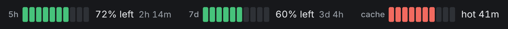
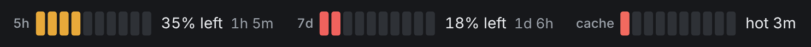
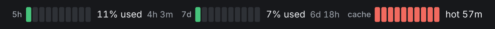

# usage-hud

A Claude Code mod that shows your plan usage and prompt cache state while you work:

- 5-hour window: bar, percent left (or used), time until reset
- 7-day window: bar, percent left (or used), time until reset
- Prompt cache: hot with time left (bar drains toward cold), or cold

It draws a one-line strip above the message box. Type `/usage-hud` to print the same readout as text.



In a terminal it draws the same readout as text:

```
5h [##########] 98% 2h 56m  |  7d [##########] 100% 6d 23h  |  Cache [#########-] hot 52m
```

Bars are green above 50% left, amber from 20% to 50%, red under 20%. Readings older than 10 minutes are dimmed.

## Look

One look: pips. Each block is ten tall bars, like a battery meter, lit for the amount (or, with `usage` set to `used`, the amount used), then the percent and the reset time. The bars are green above 50% left, amber from 20% to 50%, red under 20%. The cache bars are red while hot (draining as its time runs out) and all blue when cold. The bars widen to fill the strip; on a narrower window the reset time and the words give way before the bars shrink, and only a very narrow window turns them into small squares.

| State | Strip |
|---|---|
| Healthy |  |
| Running low, cache nearly cold |  |
| 5-hour limit reached, cache cold |  |
| `usage` set to `used` |  |

Screenshots are the desktop strip at 99 columns (742 px), dark.

The terminal always draws the text strip shown above. The pips are drawn in dark colours (the app does not tell a mod whether it is in light or dark mode). They show whole minutes and redraw at most once a minute; only the text strip counts down seconds in the last 10 minutes of the cache.

Changed in 0.4.0: the default look changed from `christmas` to `terminal`, and the festive `christmas` look was removed. A saved value of `christmas` now falls back to the default look (`terminal`). The docked pane was removed too: the mod now shows only the strip above the message box, and `/usage-hud` only prints the readout as text.

Changed in 0.4.1: the strip shows only the time until reset (for example `4h 50m`); the "as of" note is gone, and stale readings are dimmed instead. In midnight, paper, terminal, sunset and mono, the cache text is red while hot and blue when cold.

Changed in 0.5.0: new option `usage` (see Left or used below). Each limit can show its percent left (the default, as before) or its percent used.

Changed in 0.6.0: two new simple looks, `flat` and `pips` (see the list above). The default look is still `terminal`.

Changed in 0.7.0: new option `keepWarm` (see Keep warm below), off by default. `pips` draws bigger squares, and its cache squares are red while hot and all blue when cold.

Changed in 0.8.0: `pips` draws tall bars, about twice as tall as before, and keeps every word. The big squares are a new look, `squares`. The `classic`, `midnight` and `mono` looks were removed; a saved value of any of them now falls back to the default look (`terminal`). Screenshots of every look are in `docs/screenshots`.

Changed in 0.9.0: pips is the only look. The `theme` option is gone, and with it `terminal`, `clean`, `paper`, `sunset`, `flat`, `squares` and `text`; a saved `theme` value is ignored and the desktop draws pips. The terminal still draws the text strip. The pips bars are 25% taller (22.5 px), the text is a size larger, and the bars widen to fill the strip.

## Left or used

Option `usage`:

- `remaining` (default): each limit shows how much is left, for example `72%`, and its bar drains as you use it.
- `used`: each limit shows how much is spent, for example `28%`, and its bar fills up as you use it.

The two always add up to 100. The colours stay tied to what is left either way: green above 50% left (under 50% used), amber from 20% to 50% left (50% to 80% used), red under 20% left (over 80% used). The cache always shows time left. `/usage-hud` says `left` or `used` after each percent, and so does the text strip at the widths where the word fits.

```
5h [###-------] 28% 2h 14m  |  7d [######----] 60% 3d 4h  |  Cache [#######---] hot 41m
```

Set it with `/plugin configure usage-hud@cj-mods` in a terminal session.

## Install

Needs Claude Code with mod support (tested on 2.1.309 and 2.1.316) and a Claude subscription (rate limits are not reported on API keys).

From a terminal (PowerShell, bash or zsh):

```
claude plugin marketplace add luckyajinn/usage-hud
claude plugin install usage-hud@cj-mods --scope user
```

Or in the Claude desktop app: click + next to the prompt box, then Plugins, Add marketplace with `luckyajinn/usage-hud`, then add usage-hud.

Then start a new session. In the desktop app, use a local Code session.

## Where it shows

| Where | Shows |
|---|---|
| Terminal (`claude`) | Text strip above the prompt |
| Desktop app, local Code session | Strip above the message box |
| Cloud session (claude.ai/code or viewed in the desktop app) | Installs and runs, but nothing is shown today (see Cloud sessions) |

## Cloud sessions

Short version: it installs and runs in a cloud session, but the strip does not show there today.

Why: mods draw only on a screen that is connected to the session (a terminal, or the desktop app running a local Code session). When you open a cloud session in the desktop app or on claude.ai/code, the app does not connect its screen to that session for mods, so there is nothing to draw on. This is a limit of the app, not of this mod; other mods (for example ribbon) behave the same way.

| In a cloud session | Status |
|---|---|
| Install from the setup script | Works (tested) |
| Mod loads and tracks usage and cache | Works (tested) |
| Strip above the message box | Not shown today |
| `/usage-hud` text readout | Not tested yet |

To install it in every new cloud session, add these two lines to your cloud environment's setup script (environment settings, Setup script):

```
claude plugin marketplace add luckyajinn/usage-hud
claude plugin install usage-hud@cj-mods --scope user
```

Ready for later: if the app starts connecting its screen to cloud sessions, the mod notices the moment that happens and the strip draws there, with no update needed.

## Cache estimate

No API reports the prompt cache directly. The mod stamps the start of each main-thread request that read or wrote the cache, and counts down the cache lifetime per chat. The lifetime defaults to 1 hour. Option `cacheTtl`:

- `auto` (default): 1 hour, changed when Claude Code itself reports a different lifetime (on a model switch, or on resume)
- `5m` or `1h`: forced

Set it with `/plugin configure usage-hud@cj-mods` in a terminal session.

## Keep warm

Option `keepWarm`:

- `off` (default): the mod only shows the cache, as before.
- `on`: when the hot cache is under 5 minutes from expiring (1 minute on a 5-minute cache), the mod sends one short message into that chat:

  ```
  warm (usage-hud keeping the prompt cache warm: reply with only "ok", no tools)
  ```

  Claude replies "ok", and that reply reads the cache, so it stays warm for another full lifetime. The message shows in the chat as sent by the usage-hud plugin.

Each warm is a real turn. It reads the whole conversation from the cache and counts toward your 5-hour and 7-day usage, so it trades a little usage now for not paying to rebuild the cache later. To keep that bounded:

- At most 3 warms in a row while you are away. Anything you type starts the count over.
- No warm while a turn is running, when the cache is already cold, or when either limit is reached or has 5% or less left.
- One warm per cache refresh, in the chat whose cache it is.

Set it with `/plugin configure usage-hud@cj-mods` in a terminal session. It works wherever the mod runs, including cloud sessions where the strip itself is not shown.

## Updating

```
claude plugin marketplace update cj-mods
claude plugin update usage-hud@cj-mods
```

Then start a new session.

## Uninstall

```
claude plugin uninstall usage-hud@cj-mods --scope user
claude plugin marketplace remove cj-mods
```

## Notes

- The mod API is early access. If a Claude Code update changes the hooks, the mod draws nothing rather than wrong numbers.
- It stores only the last rate-limit reading (kind, percent used, reset time) and the learned cache lifetime, on your machine. No network calls, no file access. With `keepWarm` on, it sends the warm message described above into the chat; nothing else.

## Development

```
claude plugin validate .
claude plugin test .
```

MIT license. Idea credit: ribbon by RoboNuggets (see NOTICE).
